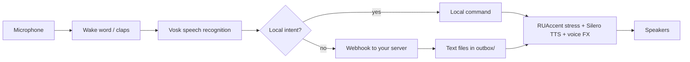

# Jarvis

**English** · [Русский](README.ru.md)

[](https://github.com/semenkulikov/JARVIS-core/actions/workflows/tests.yml)
[](LICENSE)


Current version: 3.24.0 — see the [changelog](CHANGELOG.md).

An offline Russian-language voice assistant for Windows. Say "Джарвис" (or clap twice),
give a command, hear the answer. Speech recognition and speech synthesis run on your
machine, so local commands need no network and no account. Free-form questions can be
forwarded to your own AI server through a simple webhook.

## Features

- **Activation:** wake word "Джарвис" / "hey Jarvis" (openWakeWord + Vosk) or two claps;
  extra names such as «нубас», «железяка» or «кусок железа» work the same way and are configurable (`wake_names`).
- **Schedule:** a daily alarm at full volume, a Grok-written plan for the day an hour later,
  and a bedtime reminder (`schedule`).
- **Protocols:** one phrase runs a chain of steps. «протокол спящая красавица» is for going to bed
  or a call: pause music and keep Jarvis silent until the alarm (or «… на час»), windows stay open.
  «протокол бобик сдох» ends the workday at once: close every window, pause music, lock the screen.
  Personal steps (paths, hosts) can live in a local gitignored file merged over the config.
- **Cheat sheet overlay:** «покажи шпаргалку» / «убери шпаргалку» or Ctrl+Alt+J toggles a card styled like the
  Xbox Game Bar Performance widget: protocols, main commands and every command by category in foldable sections,
  draggable by its header. Pinned (button or Ctrl+Alt+Shift+J), it stays on top as text on a transparent,
  click-through background. Position, pin and folds are remembered.
- **Strict wake word:** every wake is re-checked by free recognition; background speech,
  videos and garbled phrases are dropped; when the name was heard but the phrase is dropped, a short
  low tone says so (`reject_beep_enabled`). Optional owner-voice verification (WeSpeaker ONNX, off by default).
- **Two end-of-phrase pauses:** a phrase ends after 0.95 s of silence, a fully recognised safe command
  after 0.45 s (`phrase_silence_s`, `phrase_silence_fast_s`).
- **Follow-ups without the wake word:** the microphone stays open for up to 6 seconds after
  a reply, with echo and low-confidence filtering.
- **Instant acknowledgements:** «Да, сэр?» on the bare name, «Есть, сэр.» while an action runs.
- **Local commands:** time, battery, temperature, volume and media keys, screenshots,
  free disk space, screen off and lock, close window, read clipboard, quick notes,
  read-only Git status, open apps and projects.
- **Timers and recurring reminders** that survive restarts.
- **Modes:** focus, sleep (screen lock), workout, and a Jarvis sleep mode that keeps it
  silent for a set time until «Джарвис, проснись».
- **Your day from a status cache:** status, all tasks with times, what is left, a morning
  briefing on demand, Notion projects; anything the cache lacks goes to your server.
- **Optional integrations:** local FatSecret food logging, health checks of your servers,
  project test runs, «explain this error» and confirm-in-chat requests for your server.
- **«Что ты умеешь»:** a spoken summary built from the command registry.
- **Shutdown with a safety step:** a delay plus a separate spoken confirmation; can be cancelled.
- **Interruption:** "стоп", "замолчи" and similar phrases cut the speech; a new command
  with the wake word takes priority.
- **Streaming answers:** replies from the server are spoken sentence by sentence while the
  next one is being synthesized. Requests run in a background queue, so local commands keep
  working while the server thinks; only «стоп» during its reply cancels a request.
- **Proactive announcements:** queue, quiet hours, do-not-disturb, calendar reminders.
  Personal scenarios (training, nutrition, morning briefing) are off by default.
- **Reliability:** a supervisor restarts the listener after a crash with backoff; a planned
  restart is a `stop` file plus the start script (easy to wrap in a scheduled task); secrets
  live in Windows Credential Manager; every request produces a latency trace.

## How it works



A conservative fuzzy router matches the phrase against known commands first. Anything
else goes to the webhook; the server answers by writing plain-text files into the local
`outbox/` folder, and the listener speaks them as they appear.

The listener is the `src/jarvis/` package in four layers: `core` (pure rules, typed
ports, the listener state machine), `adapters` (microphone, Vosk, TTS, webhook, files),
`commands` (one module per area, handlers registered with `@handles("action")`) and `app`
(the conversation, the microphone loop and the composition root `build_app()`).
All code lives in the package; `src/` keeps three thin entry points (the supervisor, the
listener process and the FatSecret CLI). Everything is type-checked with strict mypy. Details and diagrams:
[docs/ARCHITECTURE.md](docs/ARCHITECTURE.md).

## Requirements

- Windows 10 or 11, Python 3.12 (x64), a microphone and speakers. No admin rights needed.
- CPU only; no GPU is required.
- Three models downloaded separately (they are not bundled): a small Vosk Russian model,
  Silero `v5_6_ru`, and the openWakeWord `hey_jarvis` model. RUAccent downloads its own
  weights on first start.

## Quick start

```powershell
git clone https://github.com/semenkulikov/JARVIS-core.git
cd JARVIS-core
py -3.12 -m venv .venv
.\.venv\Scripts\python.exe -m pip install -r requirements.txt
New-Item -ItemType Directory -Force .\runtime | Out-Null
Copy-Item .\config.example.json .\runtime\config.json
```

Download the models into `runtime\models\` as described in
[docs/SETUP_WINDOWS.md](docs/SETUP_WINDOWS.md), then start the assistant:

```powershell
wscript.exe .\start_jarvis.vbs
```

The listener runs hidden and **may speak out loud**. To stop it, create the file
`runtime\stop`. Logs are in `runtime\logs\jarvis_voice.log`.

## Example commands

The assistant understands Russian only. Say "Джарвис" first; during a conversation the
name can be skipped.

| Say | Result |
|---|---|
| «который час» | Current time |
| «таймер на пять минут» | Timer that survives a restart |
| «каждые сорок пять минут напоминай встать» | Recurring reminder |
| «громкость на тридцать» | Volume to 30% |
| «сделай скриншот» | Screenshot saved to `runtime/screenshots/` |
| «сколько свободно на диске» | Free space on the system drive |
| «прочитай буфер» | Reads the clipboard aloud |
| «запиши идею …» | Appends a note to `runtime/notes.md` |
| «последний коммит проекта …» | Last commit of a project in your projects folder |
| «режим фокуса» | Pauses music and starts a break timer |
| «выключи через десять минут» | Asks for confirmation; say «да» to schedule shutdown |
| «не беспокоить» | Silences proactive announcements |
| «повтори», «помедленнее» | Repeats the last reply, optionally slower |

The full list is in [docs/COMMANDS.md](docs/COMMANDS.md) (Russian).

## Connecting your own server (optional)

Leave `webhook_url` empty to use local commands only. To enable free-form questions,
set it in `runtime/config.json` and store the `Authorization` value in Credential Manager:

```powershell
.\.venv\Scripts\python.exe .\scripts\credentials.py set webhook_auth_header
```

The listener sends an HTTP POST with JSON:

```json
{
  "request_id": "generated-uuid",
  "text": "what the user said",
  "trigger": "wake_word",
  "listener_ack": "Сейчас, сэр.",
  "kind": "free"
}
```

The server replies by writing `outbox/<request_id>.1.txt`, `.2.txt`, … and finally
`<request_id>.txt`. Each file is plain UTF-8 text, written to a temporary name and then
renamed. The server is not part of this repository. The full contract, including
request kinds and proactive announcements, is in [docs/PAYLOADS.md](docs/PAYLOADS.md)
and [docs/PROACTIVE_CONTRACT.md](docs/PROACTIVE_CONTRACT.md) (Russian).

## Tests

The test suite needs no models, audio, network or system access and runs on Windows and Linux:

```powershell
python -m pip install -r requirements-test.txt
python -m pytest -q
```

Latency statistics from the log: `python scripts/latency_summary.py --last 20`.

## Limitations

- The listener works on Windows only; CI covers the model-free logic on Linux too.
- Russian only: commands, speech recognition and synthesis.
- Recognition and stress placement are not perfect.
- The wake word and the spoken shutdown confirmation are not authentication. A video
  or another person can trigger the assistant. The optional speaker verification lowers
  that risk but is not a security boundary.
- The server side is not included, so free-form questions need your own backend.
- Models and third-party libraries have their own licenses.

## Documentation

All documents except this README are in Russian.

- [Windows setup](docs/SETUP_WINDOWS.md)
- [Commands](docs/COMMANDS.md) · [Configuration](docs/CONFIGURATION.md)
- [Architecture](docs/ARCHITECTURE.md)
- [Webhook and outbox](docs/PAYLOADS.md) · [Proactive announcements](docs/PROACTIVE_CONTRACT.md)
- [Security](SECURITY.md) · [Changelog](CHANGELOG.md)

## Roadmap

- A Windows installer for the environment and the three speech models.
- Piper as a packaged second voice next to Silero.

## Contributing

Issues and pull requests are welcome in Russian or English. How to run the tests and what not to commit: [CONTRIBUTING.md](CONTRIBUTING.md).

## Security

Report a vulnerability by email, not in a public issue: [saifutdinov2006@mail.ru](mailto:saifutdinov2006@mail.ru). Rules for secrets, the clipboard and shutdown are in [SECURITY.md](SECURITY.md).

## License

The project code is released under the [MIT License](LICENSE). Speech models and
third-party libraries are covered by their own licenses.

Author: Semyon Saifutdinov.
