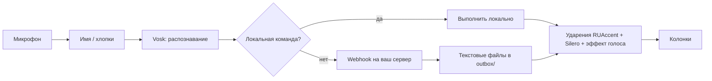

# Jarvis

[English](README.md) · **Русский**

[](https://github.com/semenkulikov/JARVIS-core/actions/workflows/tests.yml)
[](LICENSE)


Текущая версия: 3.18.0 — см. [историю изменений](CHANGELOG.md).

Офлайн-голосовой помощник для Windows на русском языке. Скажите «Джарвис» (или хлопните
дважды), назовите команду и услышите ответ. Распознавание и синтез речи работают на вашем
компьютере: для локальных команд не нужны ни интернет, ни аккаунт. Свободные вопросы можно
передавать вашему собственному AI-серверу через простой webhook.

## Возможности

- **Активация:** слово «Джарвис» / hey Jarvis (openWakeWord + Vosk) или два хлопка.
- **Строгое имя:** каждое срабатывание перепроверяется свободным распознаванием; фон, видео
  и неразборчивые фразы отбрасываются молча. Необязательная проверка голоса владельца
  (WeSpeaker ONNX, по умолчанию выключена).
- **Продолжение без имени:** микрофон остаётся открытым до 6 секунд после ответа; есть
  защита от эха и от слабо распознанных фраз.
- **Мгновенные отклики:** «Да, сэр?» на голое имя, «Есть, сэр.», пока команда выполняется.
- **Локальные команды:** время, заряд, температура, громкость и медиаклавиши, скриншот,
  свободное место на диске, выключение экрана и блокировка, закрытие окна, чтение буфера
  обмена, быстрые заметки, статус Git (только чтение), запуск приложений и проектов.
- **Таймеры и повторяющиеся напоминания**, которые переживают перезапуск.
- **Режимы:** фокус, сон (блокировка), тренировка и спящий режим самого помощника на
  заданное время — до «Джарвис, проснись».
- **День из кэша статуса:** статус, все задачи со временем, что осталось, утренний брифинг
  по запросу, проекты Notion; чего нет в кэше, спрашивается у вашего сервера.
- **Необязательные интеграции:** запись еды в FatSecret, проверка ваших серверов, запуск
  тестов проектов, «объясни ошибку» и действия с подтверждением в чате.
- **«Что ты умеешь»:** короткий рассказ из реестра команд.
- **Выключение компьютера с защитой:** задержка и отдельное голосовое подтверждение,
  выключение можно отменить.
- **Прерывание:** «стоп», «замолчи» и похожие фразы останавливают речь; новая команда
  с именем имеет приоритет.
- **Потоковые ответы:** ответ сервера озвучивается по предложениям, пока синтезируется
  следующее.
- **Проактивные объявления:** очередь, тихие часы, «не беспокоить», напоминания о событиях
  календаря. Личные сценарии (тренировки, питание, утренний брифинг) по умолчанию выключены.
- **Надёжность:** supervisor перезапускает listener после сбоя с нарастающей паузой;
  секреты хранятся в Windows Credential Manager; для каждого запроса пишется трасса задержек.

## Как это работает



Сначала осторожный нечёткий router сопоставляет фразу с известными командами. Всё остальное
уходит на webhook; сервер отвечает, записывая обычные текстовые файлы в локальную папку
`outbox/`, а listener озвучивает их по мере появления.

## Требования

- Windows 10 или 11, Python 3.12 (x64), микрофон и колонки. Права администратора не нужны.
- Только CPU, видеокарта не требуется.
- Три модели скачиваются отдельно (в репозиторий они не входят): небольшая русская модель
  Vosk, Silero `v5_6_ru` и модель `hey_jarvis` для openWakeWord. RUAccent сам скачивает
  веса при первом запуске.

## Быстрый старт

```powershell
git clone https://github.com/semenkulikov/JARVIS-core.git
cd JARVIS-core
py -3.12 -m venv .venv
.\.venv\Scripts\python.exe -m pip install -r requirements.txt
New-Item -ItemType Directory -Force .\runtime | Out-Null
Copy-Item .\config.example.json .\runtime\config.json
```

Скачайте модели в `runtime\models\` по инструкции из
[docs/SETUP_WINDOWS.md](docs/SETUP_WINDOWS.md) и запустите помощника:

```powershell
wscript.exe .\start_jarvis.vbs
```

Listener работает без окна и **может говорить вслух**. Чтобы остановить его, создайте файл
`runtime\stop`. Лог: `runtime\logs\jarvis_voice.log`.

## Примеры команд

Сначала произнесите «Джарвис»; в ходе разговора имя можно не повторять.

| Скажите | Результат |
|---|---|
| «который час» | Текущее время |
| «таймер на пять минут» | Таймер, который переживает перезапуск |
| «каждые сорок пять минут напоминай встать» | Повторяющееся напоминание |
| «громкость на тридцать» | Громкость 30% |
| «сделай скриншот» | Снимок в `runtime/screenshots/` |
| «сколько свободно на диске» | Свободное место на системном диске |
| «прочитай буфер» | Читает буфер обмена вслух |
| «запиши идею …» | Добавляет заметку в `runtime/notes.md` |
| «последний коммит проекта …» | Последний коммит проекта из вашей папки проектов |
| «режим фокуса» | Пауза музыки и таймер перерыва |
| «выключи через десять минут» | Просит подтверждение; ответьте «да», чтобы запланировать выключение |
| «не беспокоить» | Отключает проактивные объявления |
| «повтори», «помедленнее» | Повторяет последний ответ, можно медленнее |

Полный список: [docs/COMMANDS.md](docs/COMMANDS.md).

## Подключение собственного сервера (необязательно)

Оставьте `webhook_url` пустым, чтобы пользоваться только локальными командами. Чтобы
включить свободные вопросы, укажите адрес в `runtime/config.json`, а значение заголовка
`Authorization` сохраните в Credential Manager:

```powershell
.\.venv\Scripts\python.exe .\scripts\credentials.py set webhook_auth_header
```

Listener отправляет HTTP POST с JSON:

```json
{
  "request_id": "generated-uuid",
  "text": "что сказал пользователь",
  "trigger": "wake_word",
  "listener_ack": "Сейчас, сэр.",
  "kind": "free"
}
```

Сервер отвечает, записывая `outbox/<request_id>.1.txt`, `.2.txt`, … и в конце
`<request_id>.txt`. Каждый файл — обычный текст в UTF-8, записанный под временным именем
и затем переименованный. Сервера в этом репозитории нет. Полный контракт, виды запросов
и проактивные объявления описаны в [docs/PAYLOADS.md](docs/PAYLOADS.md)
и [docs/PROACTIVE_CONTRACT.md](docs/PROACTIVE_CONTRACT.md).

## Тесты

Тестам не нужны модели, звук, сеть и системные действия; они работают на Windows и Linux:

```powershell
python -m pip install -r requirements-test.txt
python -m pytest -q
```

Статистика задержек из лога: `python scripts/latency_summary.py --last 20`.

## Ограничения

- Listener работает только на Windows; CI проверяет логику без моделей ещё и на Linux.
- Только русский язык: команды, распознавание и синтез.
- Распознавание и расстановка ударений не безупречны.
- Имя активации и голосовое подтверждение выключения не являются аутентификацией:
  помощника может активировать видео или другой человек. Необязательная проверка голоса
  снижает этот риск, но не является защитой.
- Серверной части в репозитории нет, для свободных вопросов нужен свой backend.
- У моделей и сторонних библиотек свои лицензии.

## Документация

- [Установка на Windows](docs/SETUP_WINDOWS.md)
- [Команды](docs/COMMANDS.md) · [Настройки](docs/CONFIGURATION.md)
- [Архитектура](docs/ARCHITECTURE.md)
- [Webhook и outbox](docs/PAYLOADS.md) · [Проактивные объявления](docs/PROACTIVE_CONTRACT.md)
- [Безопасность](SECURITY.md) · [История изменений](CHANGELOG.md)

## Дальше

- Установщик Windows: окружение и три речевые модели.
- Piper как второй готовый голос рядом с Silero.

## Участие

Замечания и запросы на слияние можно писать по-русски или по-английски. Как запустить тесты и что не коммитить: [CONTRIBUTING.md](CONTRIBUTING.md).

## Безопасность

Об уязвимости пишите на почту, не в публичную задачу: [saifutdinov2006@mail.ru](mailto:saifutdinov2006@mail.ru). Правила для секретов, буфера обмена и выключения — в [SECURITY.md](SECURITY.md).

## Лицензия

Код проекта распространяется по лицензии [MIT](LICENSE). Модели распознавания и синтеза
речи и сторонние библиотеки имеют собственные лицензии.

Автор: Semyon Saifutdinov.
