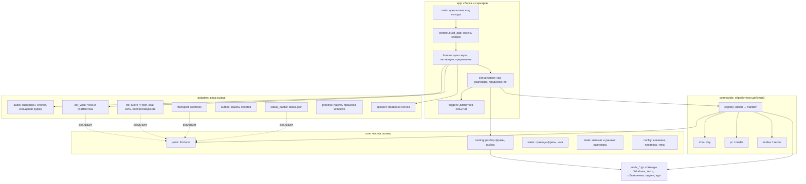
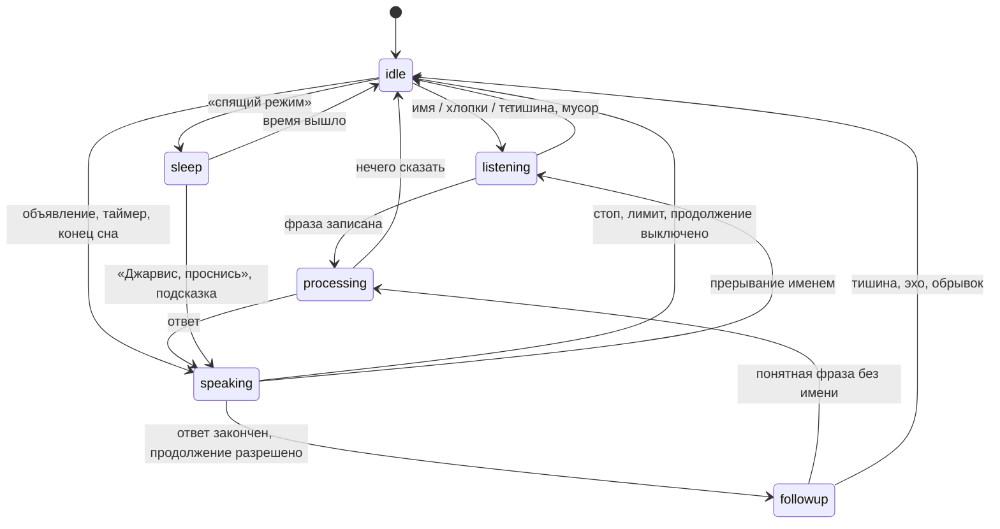

# Архитектура

Документ описывает целевое устройство помощника и план перехода к нему. Поведение при переходе
не меняется: каждый шаг — отдельный коммит, после которого проходят тесты и линтер.

## Принципы

- **Слои и направление зависимостей.** `app` → `commands` → `core`; `adapters` реализуют порты из
  `core`. Ядро не знает о микрофоне, Vosk, Silero, HTTP, файлах и Windows.
- **Порты вместо конкретных движков.** Распознавание, синтез, транспорт до сервера и кэш статуса
  описаны `typing.Protocol`. Другой движок — новый адаптер, а не правка цикла.
- **Один корень сборки.** Все объекты создаются в `jarvis.app.context.build_app()` и передаются
  через конструкторы. Модульных синглтонов и `global` нет.
- **Команды как плагины.** Обработчик действия регистрируется декоратором в модуле
  `jarvis.commands.*`. Новая команда — новый модуль, запись в `jarvis_registry.py` и тест;
  главный цикл и разговор не меняются.
- **Явное состояние.** Режим слушателя — конечный автомат с допустимыми переходами, данные
  разговора — dataclass, а не словарь с произвольными ключами.
- **Границы ошибок.** Исключение одной команды или одного кадра звука не роняет процесс; падение
  процесса поднимает наблюдатель.

## Слои



| Слой | Пакет | Можно импортировать |
|---|---|---|
| Ядро | `jarvis.core` | стандартную библиотеку, NumPy, чистые модули `jarvis_text`, `jarvis_gate`, `jarvis_sleep`, `jarvis_tasks`, `jarvis_proactive`, `jarvis_commands` (разбор), `jarvis_speed` (нечёткий разбор) |
| Адаптеры | `jarvis.adapters` | ядро, драйверы и движки (sounddevice, vosk, torch, piper, urllib, ctypes) |
| Команды | `jarvis.commands` | ядро и порты; конкретные адаптеры приходят через контекст |
| Приложение | `jarvis.app` | всё; только здесь создаются объекты |

Модули `src/jarvis_*.py` старше пакета. Они уже разделены по задачам, покрыты тестами и
импортируются по плоскому имени из тестов и скриптов. Их перенос в пакет — отдельный этап плана.

## Порты

```python
class SpeechOutput(Protocol):
    def say(self, text: str, cfg: Config, role: str = "reply", private: bool = False) -> bool: ...

class Synthesizer(Protocol):
    def synthesize(self, text: str, cfg: Config) -> tuple[np.ndarray, int]: ...

class PhraseRecognizer(Protocol):
    def capture(self, cap: Capture, cfg: Config, nospeech_s: float, skip_s: float = 0.0,
                max_s: float | None = None, wake_pause_s: float | None = None) -> tuple[str, float, str]: ...

class ServerTransport(Protocol):
    def send(self, request: ServerRequest, cfg: Config) -> bool: ...

class StatusSource(Protocol):
    def cached_status(self, field: str | None, cfg: Config) -> tuple[str, str, float | None]: ...
```

В тестах порты подменяются простыми объектами; настоящие микрофон, сеть и действия Windows
по-прежнему запрещены в `tests/conftest.py`.

## Команды

Разбор фразы (`core.routing.match_alias`) возвращает описание действия: `{"action": "timer", ...}`.
Диспетчер `commands.registry` находит обработчик по `action`:

```python
@handles("battery")
def battery(ctx: CommandContext, al: Alias) -> None:
    pct, ac = ctx.system.battery()
    ...
```

`CommandContext` — неизменяемый dataclass: текст, конфигурация, триггер, признак теста и сервисы
(`say`, `say_reply`, `ask_server`, кэш статуса, контроллер быстрых команд). Обработчики не знают
о цикле звука. `jarvis_registry.py` остаётся единым описанием команд для «что ты умеешь» и
`docs/COMMANDS.md`; тест проверяет, что у каждого действия есть обработчик.

## События и диспетчер

Источники событий — имя, хлопки, продолжение без имени, объявления, таймеры, конец сна, подсказка
во сне, подтверждение «стоп», тестовые файлы. Цикл превращает их в триггер и запускает
`Conversation.handle(trigger)`. Служебные триггеры (`proactive`, `timer_fire`, `sleep_end`,
`sleep_hint`, `stop_ack`) обрабатываются таблицей `trigger → handler`; голосовые идут в разбор.

## Состояния слушателя



`core.state.ListenerFSM` хранит режим и проверяет переход; недопустимый переход пишется в журнал
как ошибка, но не останавливает разговор. Режим виден в журнале строкой `state a -> b (причина)`.

## Потоки

| Поток | Что делает | Общие данные |
|---|---|---|
| Обратный вызов PortAudio | кладёт кадры 80 мс в очередь, при переполнении выбрасывает | `audio_q` |
| Главный цикл (`listener`) | имя, хлопки, сон, прерывание, объявления, таймеры, память | читает `ListenerState`, ставит `interrupt` |
| Разговор (один за раз) | запись фразы, разбор, команды, ожидание сервера, продолжение | владеет `ListenerState`, флаг `busy` |
| Синтез в `say` | готовит следующий кусок, пока играет текущий | очередь на 2 куска, `_SYN_LOCK` |
| POST на сервер | запрос идёт параллельно с короткой репликой | результат в списке, `cancelled` |
| Наблюдатель `outbox` | события файлов будят ожидание ответа | `OutboxSignal` |
| Прогрев | Vosk, синтез, RUAccent, шаблоны фраз | пауза, пока занят разговор |
| Утренний брифинг | отдельный POST без ожидания ответа | `proactive.Manager` |

Правила: разговор всегда один (`busy`); прерывание — только `threading.Event`; звук играет только
поток разговора; долгие операции проверяют `interrupt`.

## Конфигурация

`core.config.ConfigStore` собирает значения по умолчанию из модулей, читает `config.json` при
изменении времени файла, применяет миграции и проверяет типы по образцу значений по умолчанию.
Ошибка типа пишется в журнал и не мешает запуску, как и раньше. Типизированные секции
(`FollowupSettings`, `ServerSettings`) читаются из того же словаря, поэтому старые модули и
`config.json` остаются совместимыми.

## Журнал

Один журнал `jarvis` с ротацией, формат строк не меняется: на нём держатся `PERF`,
`scripts/latency_summary.py` и проверка после выкладки (`listening (vX)`). Новые записи пишутся как
`событие ключ=значение`. Текст буфера обмена и ответов про код не пишется (`private`).

## Границы ошибок

- Итерация главного цикла: исключение пишется в журнал, цикл продолжает работу через 0,5 с.
- Ход разговора и вся серия продолжения: исключение пишется, флаги сбрасываются, слушатель
  возвращается к ожиданию имени.
- Адаптеры поднимают исключения; запрос к серверу повторяется до 30 с, кроме ошибок 4xx.
- Процесс: наблюдатель перезапускает после сбоя с паузой 2–300 с; защита памяти выходит с кодом
  перезапуска только в простое.

## План перехода

| Этап | Что | Статус |
|---|---|---|
| 1 | Этот документ, mypy для пакета `jarvis` в CI | в работе |
| 2 | `core`: разбор фраз, границы фразы и имени, политика кэша, тренировки | план |
| 3 | `core`: конфигурация с проверкой, фразы, состояние и автомат | план |
| 4 | `adapters`: синтез и воспроизведение, сервер и `outbox`, кэш статуса, Vosk, звук, память, голос | план |
| 5 | `commands`: обработчики действий с регистрацией и проверкой полноты | план |
| 6 | `app`: разговор, цикл, корень сборки; `jarvis_voice.py` — тонкая точка входа | план |
| 7 | Перенос `jarvis_*.py` в `jarvis.core` / `jarvis.adapters` с короткими модулями-переходниками | дальше |
| 8 | Строгий mypy для всего `src`, типизированные секции для всех ключей | дальше |

## Модули `src/`

| Файл в `src/` | Что делает |
|---|---|
| `jarvis_voice.py` | Микрофон, активация, запись фразы, разбор, продолжение, синтез, запрос и `outbox` |
| `jarvis_text.py` | Русские числа, падежи, время, латиница, RUAccent и словарь ударений |
| `jarvis_speed.py` | Замеры задержек, события `outbox`, нечёткий разбор команды, заготовки фраз |
| `jarvis_fx.py` | Тембр через NumPy и SciPy |
| `jarvis_commands.py` | Быстрые команды, действия Windows, таймеры на диске, подтверждение выключения |
| `laptop.py` | Клавиши, экран, батарея, температура, поиск проектов |
| `jarvis_proactive.py` | Очередь, расписания, присутствие, календарь, «не беспокоить», без повторов |
| `jarvis_runtime.py` | Одна копия, намеренная остановка, нарастающая пауза после сбоев |
| `jarvis_supervisor.py` | Один рабочий процесс, перезапуск после сбоя, без прав администратора |
| `jarvis_credentials.py` | Только свои записи в диспетчере учётных данных Windows |
| `jarvis_paths.py` | Пути рабочего каталога. При импорте файлы не создаёт |
| `jarvis_codemode.py` | «Объясни ошибку», запросы с подтверждением в чате |
| `jarvis_projects.py` | Проверка серверов, запуск тестов проекта, отчёты |
| `jarvis_registry.py` | Единый список команд: описание, примеры, «что ты умеешь», таблица в COMMANDS.md |
| `jarvis_tasks.py` | «Утренний брифинг», «что ещё осталось», «все задачи», «что по ноушену»: из кэша или с сервера |
| `jarvis_vocab.py` | Написание слов как в словаре Vosk («ещё», «отчёт») для грамматики |
| `jarvis_dialog.py` | Какие команды получают мгновенный отклик, отклик параллельно с выполнением |
| `jarvis_food.py` | Разбор «добавь 200 грамм …», словарь продуктов, дневник FatSecret без повторов |
| `fatsecret_call.py` | Необязательный клиент OAuth1 для FatSecret |

## Что лежит только на диске

`JARVIS_HOME` по умолчанию — каталог `runtime/` рядом с `src/`:

```text
runtime/
  config.json
  models/                 # отдельно скачанные Vosk, Silero и модель имени
  cache/status.json       # данные вашего сервера
  cache/status.txt        # необязательный текстовый снимок
  cache/tts/              # готовые WAV
  cache/timers.json
  cache/proactive_state.json
  outbox/                 # только текст; done/ — уже озвученные файлы
  screenshots/
  notes.md
  logs/jarvis_voice.log
  logs/supervisor.log
  stop                    # просьба остановиться
  cache/intentional_stop  # наблюдатель не поднимает процесс, остановленный вручную
```

Этих файлов, моделей и звука в Git нет. Каталог проектов задаётся ключом `projects_dir` или переменной `JARVIS_PROJECTS`.

## Скорость

Одна небольшая модель Vosk служит и командам, и свободным вопросам. Для команд словарь дополнительно сужен. В фоне заранее готовятся Vosk, синтез и RUAccent. Частые фразы и короткий набор шаблонов времени хранятся целыми WAV, а не склейкой цифр.

Синтез идёт под замком: пока играет текущая фраза, готовится следующая. Папка `outbox` читается по событиям файловой системы, а если событий нет — коротким опросом. Перед чтением проверяется, что запись файла закончилась.

Строки `PERF event` и `PERF summary` содержат номер запроса и точки: пробуждение, конец речи, распознавание, маршрут, начало реплики, отправка, первый файл сервера, первый звук ответа, конец. У локальной команды части точек нет. `scripts/latency_summary.py` считает интервалы, медиану и 95-й перцентиль. Время сервера отдельно не измеряется: оно входит в ожидание файла.

Модели Vosk, Silero и RUAccent остаются в памяти процесса. Проверка на GitHub не включает микрофон и не скачивает модели.
