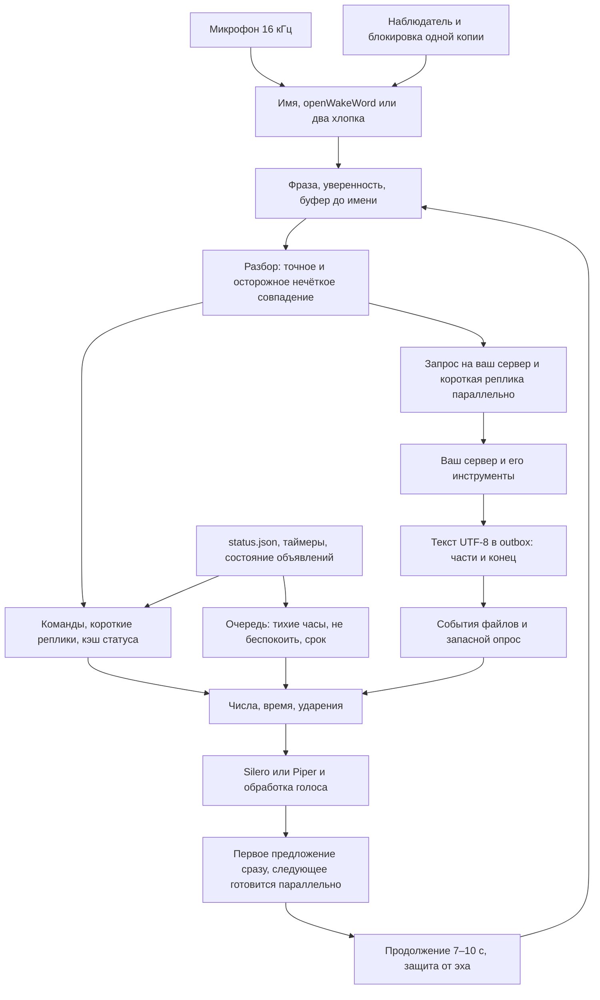

# Архитектура



## Компоненты

| Файл в `src/` | Что делает |
|---|---|
| `jarvis_voice.py` | Микрофон, активация, запись фразы, разбор, продолжение, синтез, запрос и `outbox` |
| `jarvis_text.py` | Русские числа, падежи, время, латиница, RUAccent и словарь ударений |
| `jarvis_speed.py` | Замеры задержек, события `outbox`, нечёткий разбор команды, заготовки фраз |
| `jarvis_fx.py` | Тембр через NumPy и SciPy |
| `jarvis_commands.py` | Быстрые команды, действия Windows, таймеры на диске, подтверждение выключения |
| `laptop.py` | Клавиши, экран, батарея, температура, поиск проектов |
| `jarvis_proactive.py` | Очередь, расписания, присутствие, календарь, «не беспокоить», без повторов |
| `jarvis_runtime.py` | Одна копия, намеренная остановка, нарастающая пауза после сбоев |
| `jarvis_supervisor.py` | Один рабочий процесс, перезапуск после сбоя, без прав администратора |
| `jarvis_credentials.py` | Только свои записи в диспетчере учётных данных Windows |
| `jarvis_paths.py` | Пути рабочего каталога. При импорте файлы не создаёт |
| `jarvis_codemode.py` | «Объясни ошибку», запросы с подтверждением в чате |
| `fatsecret_call.py` | Необязательный клиент OAuth1 для FatSecret |

## Что лежит только на диске

`JARVIS_HOME` по умолчанию — каталог `runtime/` рядом с `src/`:

```text
runtime/
  config.json
  models/                 # отдельно скачанные Vosk, Silero и модель имени
  cache/status.json       # данные вашего сервера
  cache/status.txt        # необязательный текстовый снимок
  cache/tts/              # готовые WAV
  cache/timers.json
  cache/proactive_state.json
  outbox/                 # только текст; done/ — уже озвученные файлы
  screenshots/
  notes.md
  logs/jarvis_voice.log
  logs/supervisor.log
  stop                    # просьба остановиться
  cache/intentional_stop  # наблюдатель не поднимает процесс, остановленный вручную
```

Этих файлов, моделей и звука в Git нет. Каталог проектов задаётся ключом `projects_dir` или переменной `JARVIS_PROJECTS`.

## Скорость

Одна небольшая модель Vosk служит и командам, и свободным вопросам. Для команд словарь дополнительно сужен. В фоне заранее готовятся Vosk, синтез и RUAccent. Частые фразы и короткий набор шаблонов времени хранятся целыми WAV, а не склейкой цифр.

Синтез идёт под замком: пока играет текущая фраза, готовится следующая. Папка `outbox` читается по событиям файловой системы, а если событий нет — коротким опросом. Перед чтением проверяется, что запись файла закончилась.

Строки `PERF event` и `PERF summary` содержат номер запроса и точки: пробуждение, конец речи, распознавание, маршрут, начало реплики, отправка, первый файл сервера, первый звук ответа, конец. У локальной команды части точек нет. `scripts/latency_summary.py` считает интервалы, медиану и 95-й перцентиль. Время сервера отдельно не измеряется: оно входит в ожидание файла.

Модели Vosk, Silero и RUAccent остаются в памяти процесса. Проверка на GitHub не включает микрофон и не скачивает модели.
