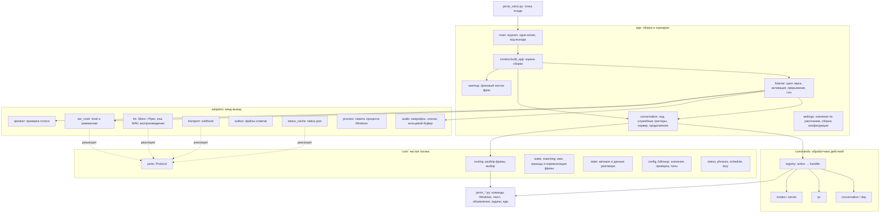
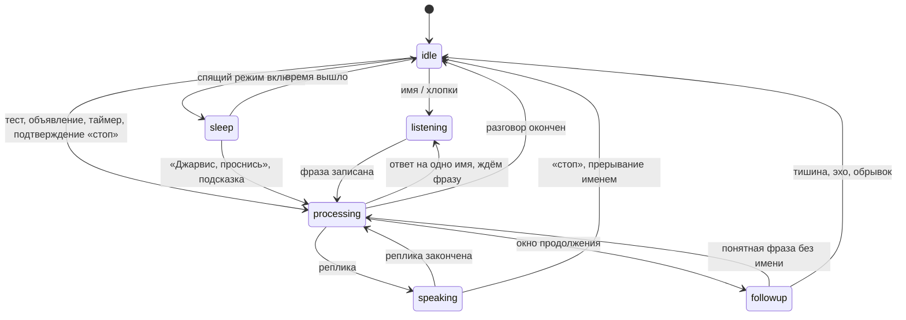

# Архитектура

Слушатель собран как пакет `src/jarvis/` из четырёх слоёв. `src/jarvis_voice.py` — точка входа
на десять строк: её запускает `jarvis_supervisor.py`, а она вызывает `jarvis.app.main.run()`.
Переход к пакету шёл отдельными коммитами без изменения поведения; после каждого проходили тесты,
ruff и mypy.

## Принципы

- **Слои и направление зависимостей.** `app` → `commands` → `core`; `adapters` реализуют порты из
  `core`. Ядро не знает о микрофоне, Vosk, Silero, HTTP, файлах и Windows. Направление импортов
  проверяет `tests/test_layers.py`.
- **Порты вместо конкретных движков.** Речь, синтез, распознавание фразы, транспорт до сервера и
  кэш статуса описаны `typing.Protocol` в `core.ports`. Другой движок — новый адаптер, а не правка
  цикла. Соответствие адаптеров портам проверяет mypy (`app.context.ports_of`).
- **Один корень сборки.** Все объекты создаются в `jarvis.app.context.build_app()` и передаются
  через конструкторы. В пакете нет `global` и модульных экземпляров; то, что нужно не сразу
  (контроллер быстрых команд, сон, объявления), создаёт `core.lazy.Lazy` при первом обращении.
- **Команды как плагины.** Обработчик действия регистрируется декоратором `@handles` в модуле
  `jarvis.commands.*`. Новая команда — новый модуль, запись в `jarvis/commands/catalog.py` и тест; цикл и
  разговор не меняются.
- **Явное состояние.** Режим слушателя — конечный автомат с допустимыми переходами, данные
  разговора — dataclass, а не словарь с произвольными ключами.
- **Границы ошибок.** Исключение одной команды или одного кадра звука не роняет процесс; падение
  процесса поднимает наблюдатель.

## Слои



| Слой | Пакет | Можно импортировать |
|---|---|---|
| Ядро | `jarvis.core` | стандартную библиотеку, NumPy, чистые модули `jarvis_text`, `jarvis_gate`, `jarvis_dialog`, `jarvis_commands` (разбор), `jarvis_tasks`, `jarvis_speed` (нечёткий разбор) |
| Адаптеры | `jarvis.adapters` | ядро, драйверы и движки (sounddevice, vosk, torch, piper, urllib, ctypes) |
| Команды | `jarvis.commands` | ядро; адаптеры приходят через `Services` |
| Приложение | `jarvis.app` | всё; только здесь создаются объекты |

Модули `src/jarvis_*.py` старше пакета. Они уже разделены по задачам, покрыты тестами и
импортируются по плоскому имени из тестов и скриптов. Их перенос в пакет — следующий этап плана.

## Порты

```python
class SpeechOutput(Protocol):
    def say(self, text: str, cfg: Config, role: str = "reply", private: bool = False) -> bool: ...

class Synthesizer(Protocol):
    def get_audio(self, text: str, cfg: Config) -> tuple[Audio, int]: ...

class PhraseRecognizer(Protocol):
    def capture(self, cap: Any, cfg: Config, nospeech_s: float, skip_s: float = 0.0,
                max_s: float | None = None, wake_pause_s: float | None = None) -> tuple[str, float, str]: ...

class ServerTransport(Protocol):
    def call(self, rid: str, text: str, trigger: str, cfg: Config, test: bool, listener_ack: str = "",
             kind: str = "free", trace: Any = None, extra_payload: dict[str, Any] | None = None) -> bool: ...

class StatusSource(Protocol):
    def cached_status(self, field: str | None, cfg: Config) -> tuple[str, str, float | None]: ...
    def load(self) -> dict[str, Any] | None: ...
```

Реализации: `adapters.tts.Voice` (речь и синтез), `adapters.asr_vosk.VoskASR`,
`adapters.transport.WebhookTransport`, `adapters.status_cache.StatusCache`. В тестах их заменяют
простые объекты; настоящие микрофон, сеть и действия Windows запрещены в `tests/conftest.py`.

## Команды

Разбор фразы (`core.routing.match_alias`) возвращает описание действия: `{"action": "timer", ...}`.
`Conversation.run_alias` собирает `CommandContext` и передаёт его `commands.registry.dispatch`:

```python
@handles("battery")
def battery(ctx: CommandContext, al: Alias) -> None:
    pct, ac = LP.battery()
    if pct is None: ctx.services.say("Не вижу батарею, сэр.", ctx.cfg); return
    ...
```

- `CommandContext` — неизменяемый dataclass: текст, конфигурация, триггер, признак теста и
  `services`.
- `Services` — порт, который реализует `Conversation`: `say`, `say_reply`, `ask_server`, `pick`,
  состояние, кэш статуса, контроллер быстрых команд, сон, объявления.
- `registry.load_builtin()` импортирует все модули пакета; у действия один владелец, повторная
  регистрация — ошибка. Действие без обработчика произносит `reply` псевдонима, как раньше.
- `jarvis/commands/catalog.py` остаётся единым описанием команд для «что ты умеешь» и `docs/COMMANDS.md`;
  `tests/test_commands_registry.py` проверяет, что у каждого действия есть обработчик.

Новая команда: модуль `src/jarvis/commands/<область>.py` с функцией под `@handles("<action>")`,
псевдоним в `app/settings.py` или разбор в `jarvis/core/quick.py`, запись в `jarvis/commands/catalog.py`, тест
с `tests/command_fakes.FakeServices`.

## События и диспетчер

Источники событий — имя, хлопки, продолжение без имени, объявления, таймеры, конец сна, подсказка
во сне, подтверждение «стоп», тестовые файлы. `Listener` превращает их в триггер и запускает
`Conversation.handle(trigger)` в отдельном потоке.

| Триггер | Кто ставит | Что делает |
|---|---|---|
| `wake_word`, `clap` | цикл: имя, хлопки, прерывание именем | запись фразы, разбор, команда или сервер |
| `followup` | разговор, окно после ответа | разбор без имени |
| `stop_ack` | цикл после «стоп» | короткое подтверждение |
| `proactive` | `jarvis_proactive.Manager` | объявление |
| `timer_fire` | таймеры `jarvis_commands` | сигнал и подпись таймера |
| `sleep_end`, `sleep_hint` | сон: «Джарвис, проснись», файл пробуждения, одно «Джарвис» | конец сна, подсказка |

Служебные триггеры разбирает `Conversation._event_turn`; голосовые идут в `handle_turn`.

## Состояния слушателя



`core.state.ListenerFSM` хранит режим и проверяет переход. В `idle` можно перейти из любого
режима. Допустимый переход пишется на уровне DEBUG, недопустимый — предупреждением
`state a -> b is not a valid transition (причина)` и счётчиком `invalid`; разговор при этом не
прерывается. После прерывания разговор уходит в `idle`, и цикл начинает новый ход с `listening`.

## Потоки

| Поток | Что делает | Общие данные |
|---|---|---|
| Обратный вызов PortAudio | кладёт кадры 80 мс в очередь, при переполнении выбрасывает | `MicInput.queue` |
| Главный цикл (`Listener.run`) | имя, хлопки, сон, прерывание, объявления, таймеры, память | читает `ListenerState`, ставит `interrupt` |
| Разговор (один за раз) | запись фразы, разбор, команды, ожидание сервера, продолжение | владеет `ListenerState`, флаг `busy` |
| Синтез в `Voice.say` | готовит следующий кусок, пока играет текущий | очередь на 2 куска, `Voice._syn_lock` |
| POST на сервер | запрос идёт параллельно с короткой репликой | результат в списке, `RequestLedger` |
| Наблюдатель `outbox` | события файлов будят ожидание ответа | `OutboxSignal` |
| Прогрев | Vosk (`vosk-warmup`), синтез и шаблоны (`tts-warmup`) | пауза, пока занят разговор |
| Утренний брифинг | отдельный POST без ожидания ответа | `proactive.Manager` |

Правила: разговор всегда один (`busy`); прерывание — только `threading.Event`; звук играет только
поток разговора; долгие операции проверяют `interrupt`.

## Конфигурация

`core.config.ConfigStore` собирает значения по умолчанию из модулей (`app.settings.DEFAULTS`),
читает `config.json` при изменении времени файла, применяет миграции и проверяет типы по образцу
значений по умолчанию. Ошибка типа пишется в журнал (`config value ...`) и не мешает запуску.
Типизированная секция `core.followup.FollowupSettings` читается из того же словаря и ограничивает
значения, поэтому старые модули и `config.json` остаются совместимыми.

## Журнал

Один журнал `jarvis` (`app.main.configure_logging`): `jarvis_voice.log`, ротация 2 МБ × 3, формат
строк прежний. На нём держатся `PERF`, `scripts/latency_summary.py` и проверка после выкладки
(`listening (vX)`, версия из `jarvis.__version__`). Записи пишутся как `событие ключ=значение`.
Текст буфера обмена и ответов про код не пишется (`private`).

## Границы ошибок

- Итерация главного цикла (`Listener.step`): исключение пишется в журнал, цикл продолжает работу
  через 0,5 с.
- Ход разговора и вся серия продолжения: исключение пишется, флаги сбрасываются, слушатель
  возвращается к ожиданию имени.
- Адаптеры поднимают исключения; запрос к серверу повторяется до 30 с, кроме ошибок 4xx.
- Процесс: `app.main.run` пишет `fatal` и выходит, наблюдатель перезапускает с паузой 2–300 с;
  защита памяти выходит с кодом перезапуска только в простое.

## План перехода

| Этап | Что | Статус |
|---|---|---|
| 1 | Этот документ, mypy для пакета `jarvis` в CI | сделано |
| 2 | `core`: разбор фраз, границы фразы и имени, политика кэша, тренировки | сделано |
| 3 | `core`: конфигурация с проверкой, фразы, состояние и автомат | сделано |
| 4 | `adapters`: синтез и воспроизведение, сервер и `outbox`, кэш статуса, Vosk, звук, память, голос | сделано |
| 5 | `commands`: обработчики действий с регистрацией и проверкой полноты | сделано |
| 6 | `app`: разговор, цикл, корень сборки; `jarvis_voice.py` — тонкая точка входа | сделано |
| 7 | Перенос `jarvis_*.py` в `jarvis.core` / `jarvis.adapters` с короткими модулями-переходниками | дальше |
| 8 | Строгий mypy для всего `src`, типизированные секции для всех ключей | дальше |

## Модули `src/`

| Файл | Строк | Что делает |
|---|---:|---|
| `jarvis_voice.py` | 10 | Точка входа для наблюдателя: потоки BLAS, затем `jarvis.app.main.run()` |
| `jarvis/app/main.py` | 41 | Журнал, одна копия слушателя, `fatal`, код выхода |
| `jarvis/app/context.py` | 99 | Корень сборки `build_app()`, проверка портов |
| `jarvis/app/components.py` | 73 | `Paths` и `Components`: все объекты слушателя |
| `jarvis/app/listener.py` | 334 | Цикл микрофона: имя, хлопки, прерывание, сон, объявления, таймеры, память |
| `jarvis/app/conversation.py` | 317 | Ход разговора, служебные триггеры, запрос и ответы сервера, продолжение |
| `jarvis/app/warmup.py` | 64 | Фоновый синтез частых фраз и шаблонов, проверка произношения |
| `jarvis/app/settings.py` | 106 | Значения по умолчанию и псевдонимы, сборка конфигурации |
| `jarvis/commands/registry.py` | 46 | `@handles`, поиск модулей, `dispatch` |
| `jarvis/commands/base.py` | 60 | `CommandContext`, порт `Services` |
| `jarvis/commands/conversation.py` | 40 | Ответ псевдонима, болтовня, «стоп», «проснись», «что ты умеешь» |
| `jarvis/commands/day.py` | 50 | Статус, задачи, время, тренировка |
| `jarvis/commands/modes.py` | 28 | Спящий режим, «не беспокоить» |
| `jarvis/commands/pc.py` | 125 | Клавиши, экран, таймеры, батарея, температура, проекты, программы |
| `jarvis/commands/server.py` | 32 | Быстрые команды контроллера, псевдонимы на сервер |
| `jarvis/core/ports.py` | 107 | Порты `Protocol` |
| `jarvis/core/state.py` | 127 | Режимы и переходы, данные разговора, сигналы, отменённые запросы |
| `jarvis/core/routing.py` | 143 | Псевдонимы, грамматика, выбор между свободным текстом и грамматикой |
| `jarvis/core/config.py` | 94 | `ConfigStore`, проверка типов, слияние псевдонимов |
| `jarvis/core/matching.py` | 86 | Нормализация фразы, обрывки, паразиты, эхо, «стоп» |
| `jarvis/core/phrases.py` | 86 | Болтовня, выбор фразы без повторов, список фраз для кэша |
| `jarvis/core/wake.py` | 65 | Имя в начале фразы, конец фразы |
| `jarvis/core/status.py` | 60 | Политика свежести кэша статуса, ответ из снимка |
| `jarvis/core/followup.py` | 37 | `FollowupSettings` |
| `jarvis/core/schedule.py` | 32 | Ответ о тренировке |
| `jarvis/core/lazy.py` | 27 | `Lazy`: объект при первом обращении |
| `jarvis/adapters/tts.py` | 212 | Синтез, кэш WAV, нарезка текста, воспроизведение с прерыванием |
| `jarvis/adapters/audio.py` | 154 | Микрофон, уровни, усиление, кольцевой буфер, выбор устройства, хлопки |
| `jarvis/adapters/asr_vosk.py` | 142 | Модель и грамматики Vosk, запись фразы, проверка имени |
| `jarvis/adapters/transport.py` | 81 | Webhook с повтором и списком разрешённых полей |
| `jarvis/adapters/outbox.py` | 120 | Файлы ответов сервера |
| `jarvis/adapters/status_cache.py` | 54 | `status.json`: статус, задачи, ссылка GitHub |
| `jarvis/adapters/speaker.py` | 130 | Необязательная проверка голоса владельца |
| `jarvis/adapters/accent.py` | 73 | Необязательные ударения RUAccent |
| `jarvis/adapters/process.py` | 42 | Память процесса Windows |
| `jarvis/core/text.py` | 279 | Русские числа, падежи, время, латиница и словарь ударений |
| `jarvis/core/numbers.py` | 40 | Числа и длительности на слух: «полтора часа», «двадцать пять» |
| `jarvis/core/perf.py` | 45 | Трассировка задержек `PERF event`/`PERF summary` |
| `jarvis/core/fuzzy.py` | 59 | Осторожный нечёткий матч коротких вопросов только для чтения |
| `jarvis/adapters/playback.py` | 53 | Воспроизведение с остановкой из потока разговора |
| `jarvis/adapters/fx.py` | 62 | Тембр через NumPy и SciPy |
| `jarvis/core/quick.py` | 81 | Быстрые команды, чистая часть: разбор фраз, длительности, спасение грамматикой |
| `jarvis/commands/controller.py` | 149 | Выполнение быстрых команд через внедрённые порты |
| `jarvis/adapters/system.py` | 128 | Действия на рабочем столе Windows за одним бэкендом |
| `jarvis/adapters/timers.py` | 67 | Постоянные таймеры, напоминания и объявления |
| `jarvis/adapters/laptop.py` | 119 | Медиаклавиши, экран, батарея, температура, папки проектов, Cursor |
| `jarvis/core/proactive.py` | 65 | Правила проактивности: тихие часы, DND, разбор времени, приоритетный вейк |
| `jarvis/adapters/proactive.py` | 184 | Постоянная очередь проактивных сообщений и утренний брифинг |
| `jarvis/adapters/runtime.py` | 81 | Одна копия, намеренная остановка, нарастающая пауза после сбоев |
| `jarvis_supervisor.py` | 7 | Точка входа супервизора для start_jarvis.vbs (тонкая обёртка) |
| `jarvis/app/supervisor.py` | 84 | Один рабочий процесс, перезапуск после сбоя, без прав администратора |
| `jarvis/adapters/credentials.py` | 94 | Только свои записи в диспетчере учётных данных Windows |
| `jarvis/adapters/paths.py` | 39 | Пути рабочего каталога. При импорте файлы не создаёт |
| `jarvis/core/codemode.py` | 102 | «Объясни ошибку», запросы с подтверждением в чате |
| `jarvis/core/projects.py` | 162 | Проекты, чистая часть: фразы, разбор настроек, сопоставление имён, ответы |
| `jarvis/adapters/project_tools.py` | 123 | Проверка серверов по HTTP/TCP и запуск тестов проектов без оболочки |
| `jarvis/commands/catalog.py` | 142 | Единый список команд: описание, примеры, «что ты умеешь», таблица в COMMANDS.md |
| `jarvis/core/tasks.py` | 186 | «Утренний брифинг», «что ещё осталось», «все задачи», «что по ноушену»: из кэша или с сервера |
| `jarvis/core/vocab.py` | 28 | Написание слов как в словаре Vosk («ещё», «отчёт») для грамматики |
| `jarvis/core/gate.py` | 66 | Отбор фраз, обращённых к помощнику: уверенность слов, подтверждение имени |
| `jarvis/core/sleep.py` | 64 | Фразы и разбор спящего режима слушателя |
| `jarvis/adapters/sleep_store.py` | 67 | Время окончания сна на диске |
| `jarvis/core/voiceprint.py` | 111 | Голосовой отпечаток: признаки fbank, косинус, профиль и порог |
| `jarvis/core/migrations.py` | 36 | Версии `config.json`: миграции при каждой загрузке |
| `jarvis/core/dialog.py` | 91 | Какие команды получают мгновенный отклик, отклик параллельно с выполнением |
| `jarvis/core/food.py` | 235 | Еда, чистая часть: разбор фразы, сопоставление продукта, итоги и ответы |
| `jarvis/adapters/food_diary.py` | 160 | Кэш продуктов, дневник FatSecret и журнал записей против дублей |
| `fatsecret_call.py` | 42 | Командная строка FatSecret для внешних вызовов (тонкая обёртка) |
| `jarvis/adapters/fatsecret.py` | 57 | Клиент OAuth1 для FatSecret |

## Что лежит только на диске

`JARVIS_HOME` по умолчанию — каталог `runtime/` рядом с `src/`:

```text
runtime/
  config.json
  models/                 # отдельно скачанные Vosk, Silero и модель имени
  cache/status.json       # данные вашего сервера
  cache/status.txt        # необязательный текстовый снимок
  cache/tts/              # готовые WAV
  cache/timers.json
  cache/proactive_state.json
  outbox/                 # только текст; done/ — уже озвученные файлы
  screenshots/
  notes.md
  logs/jarvis_voice.log
  logs/supervisor.log
  stop                    # просьба остановиться
  cache/intentional_stop  # наблюдатель не поднимает процесс, остановленный вручную
```

Этих файлов, моделей и звука в Git нет. Каталог проектов задаётся ключом `projects_dir` или переменной `JARVIS_PROJECTS`.

## Скорость

Одна небольшая модель Vosk служит и командам, и свободным вопросам. Для команд словарь дополнительно сужен. В фоне заранее готовятся Vosk, синтез и RUAccent. Частые фразы и короткий набор шаблонов времени хранятся целыми WAV, а не склейкой цифр.

Синтез идёт под замком: пока играет текущая фраза, готовится следующая. Папка `outbox` читается по событиям файловой системы, а если событий нет — коротким опросом. Перед чтением проверяется, что запись файла закончилась.

Строки `PERF event` и `PERF summary` содержат номер запроса и точки: пробуждение, конец речи, распознавание, маршрут, начало реплики, отправка, первый файл сервера, первый звук ответа, конец. У локальной команды части точек нет. `scripts/latency_summary.py` считает интервалы, медиану и 95-й перцентиль. Время сервера отдельно не измеряется: оно входит в ожидание файла.

Модели Vosk, Silero и RUAccent остаются в памяти процесса. Проверка на GitHub не включает микрофон и не скачивает модели.
