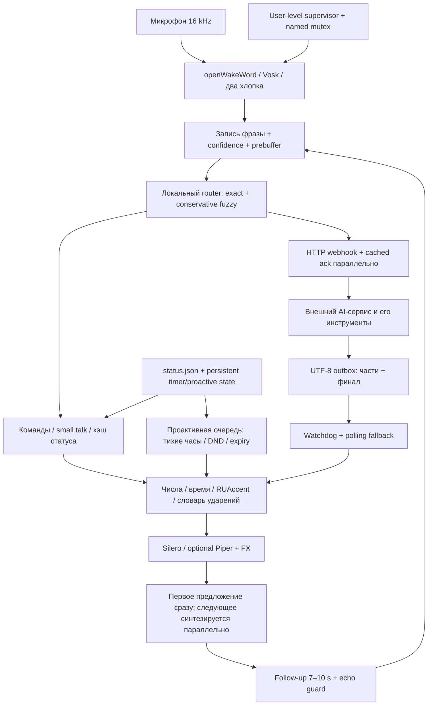

# Архитектура



## Компоненты

| Файл в `src/` | Ответственность |
|---|---|
| `jarvis_voice.py` | Микрофон, wake/claps, capture, router, follow-up, TTS, HTTP/outbox |
| `jarvis_text.py` | Русские числа/падежи/время, транслитерация, RUAccent и словарь |
| `jarvis_speed.py` | PERF-трейсы, события outbox, fuzzy intent, шаблоны предсинтеза |
| `jarvis_fx.py` | Обработка тембра через NumPy/SciPy |
| `jarvis_commands.py` | Парсер быстрых команд, OS adapter, persistent timers, подтверждение shutdown |
| `laptop.py` | Клавиши, экран, батарея, температура, поиск проектов |
| `jarvis_proactive.py` | Очередь, расписания, присутствие, календарь, DND, dedup |
| `jarvis_runtime.py` | Singleton mutex, intentional stop, crash-loop backoff |
| `jarvis_supervisor.py` | Один worker, восстановление после сбоя, без admin |
| `jarvis_credentials.py` | Только собственные scoped записи Windows Credential Manager |
| `jarvis_paths.py` | Портативные пути, не создаёт файлов на import |
| `fatsecret_call.py` | Необязательный stdlib OAuth1 adapter для внешней интеграции |

## Что находится только локально

`JARVIS_HOME` (по умолчанию `runtime/` рядом с `src/`):

```text
runtime/
  config.json
  models/                 # отдельно скачанные Vosk / Silero / wake weights
  cache/status.json       # данные внешнего сервиса
  cache/status.txt        # необязательный текстовый снимок
  cache/tts/              # синтезированные WAV
  cache/timers.json
  cache/proactive_state.json
  outbox/                 # только текст; done/ — архив обработанных файлов
  screenshots/
  notes.md
  logs/jarvis_voice.log
  logs/supervisor.log
  stop                    # запрос намеренной остановки
  cache/intentional_stop  # supervisor не перезапускает вручную остановленный worker
```

Никаких runtime-данных, моделей, аудио или credentials в Git.
Пути поиска проектов задаются через `projects_dir` / `JARVIS_PROJECTS`.

## Скорость и память

Небольшая Vosk-модель общая для command/free recognizers; команды дополнительно ограничены
грамматикой. В фоне прогреваются Vosk, TTS и RUAccent. Частые фразы/acks и ограниченный набор
временных шаблонов кешируются целыми WAV, не склейкой отдельных цифр.
Синтез защищён lock; producer подготавливает следующую фразу во время playback текущей.
Outbox использует события с резервным опросом; стабильность файла проверяется отдельно.

События `PERF event`/`PERF summary` содержат request ID и временные точки:
wake → speech_end → recognized → route → ack_start → post_start → first_server_file →
first_reply_audio → done. Отсутствующие точки допустимы для локальных команд.
`scripts/latency_summary.py` считает интервалы, median и p95; серверное время отдельно
не наблюдается и входит в ожидание файла. Рабочий набор RAM меняется после trim;
private committed memory и working set — разные показатели, не обещается фиксированная RAM.

Полноценный аудиопрогон и воспроизводимость скачивания моделей не входят в model-free CI.
